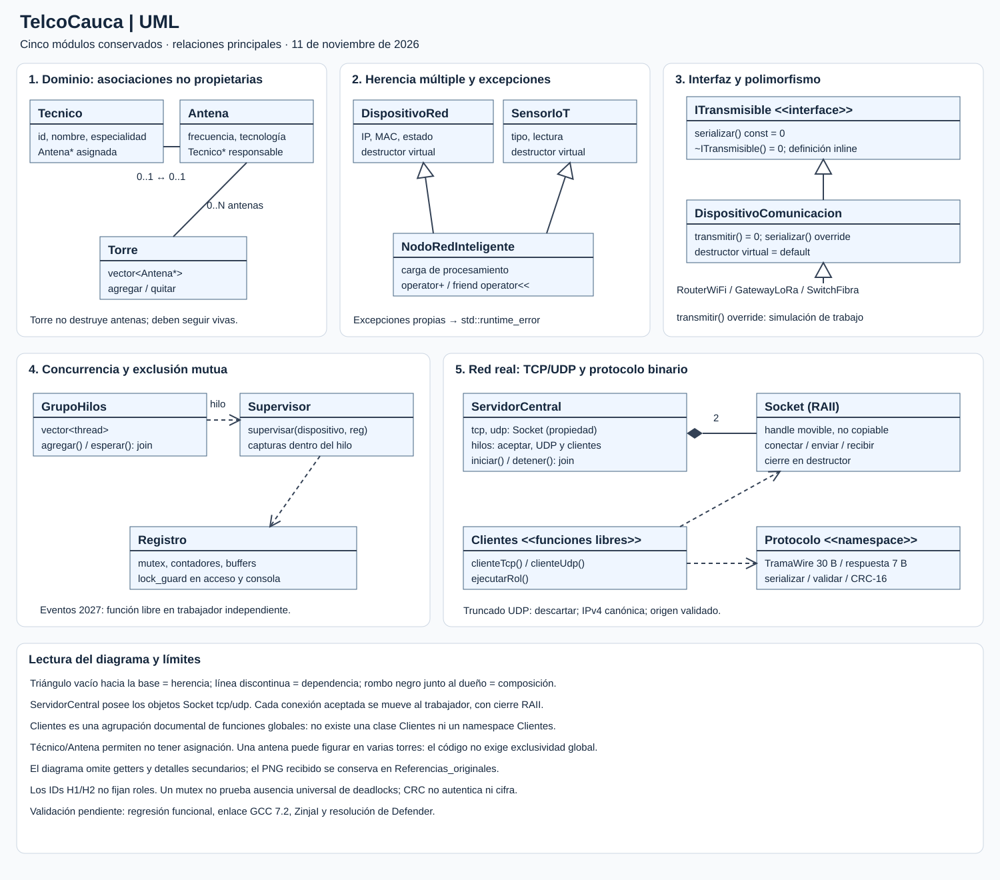

# TelcoCauca

Sistema distribuido y concurrente para monitoreo de infraestructura de telecomunicaciones e IoT, desarrollado en C++11 como proyecto integrador de Programación Orientada a Objetos.

**Universidad del Cauca - FIET - 2026.2**<br>
**Docente:** Paola Andrea Bedoya Toro (`PABTORO`)<br>
**Integrantes:** Juan Esteban Caldon Rengifo y Kevin Camilo Salazar Cordoba



## Requisitos cubiertos

| Módulo | Implementación principal | Evidencia |
|---|---|---|
| 1. Dominio UML | `Tecnico`, `Antena`, `Torre` | Encapsulamiento, asociación 1:1 y agregación 1:N |
| 2. Herencia y sobrecarga | `DispositivoRed`, `SensorIoT`, `NodoRedInteligente` | Herencia múltiple, `operator+`, `operator<<`, excepciones |
| 3. Polimorfismo puro | `ITransmisible`, `DispositivoComunicacion`, `RouterWiFi`, `GatewayLoRa`, `SwitchFibra` | Métodos virtuales puros, `override`, destructor virtual, vector polimórfico y guarda `nullptr` |
| 4. Multihilo y mutex | `GrupoHilos`, `Supervisor`, `Registro`, `Eventos` | `std::thread`, `std::ref`, `join`, `std::mutex`, `std::lock_guard` y eventos 2027 |
| 5. Sockets TCP/UDP | `Socket`, `ServidorCentral`, `Clientes`, `Protocolo` | Servidor TCP concurrente, UDP, timeouts, trama binaria de 30 bytes y ACK/NACK |

La correspondencia exacta entre la rúbrica y el código está en [docs/CUMPLIMIENTO_RUBRICA.md](docs/CUMPLIMIENTO_RUBRICA.md).

## Abrir en ZinjaI

1. Abrir `TelcoCauca.zpr`.
2. Seleccionar la configuración `C++11` incluida en el proyecto.
3. Compilar el proyecto completo. El `.zpr` registra los 37 archivos fuente: 16 `.cpp` y 21 `.h`.
4. Ejecutar y escoger una opción del menú.

El proyecto usa `-pthread` y, en Windows, enlaza Winsock mediante `-lws2_32`. No requiere bibliotecas externas.

```text
1. Infraestructura física
2. Herencia múltiple y excepciones
3. Polimorfismo e interfaces
4. Concurrencia y eventos 2027
5. Comunicación TCP/UDP
6. Demostración completa
7. Servidor y clientes en procesos independientes (Windows)
0. Salir
```

Para la sustentación de cuatro minutos se recomienda la opción `6`, que recorre los cinco módulos, crea clientes TCP/UDP concurrentes, provoca fallos controlados y comprueba que el servidor continúa atendiendo. El guion cronometrado está en [docs/GUIA_SUSTENTACION.md](docs/GUIA_SUSTENTACION.md).

## Modos de línea de comandos

| Comando | Función |
|---|---|
| `TelcoCauca --pruebas` | Ejecuta la demostración completa; devuelve 0 si todas las comprobaciones pasan |
| `TelcoCauca --servidor [puerto] [segundos]` | Inicia el servidor TCP y UDP; puerto predeterminado 5000 |
| `TelcoCauca --router [ip] [puerto]` | Ejecuta un cliente RouterWiFi |
| `TelcoCauca --gateway [ip] [puerto]` | Ejecuta un cliente GatewayLoRa |
| `TelcoCauca --sensor [ip] [puerto]` | Ejecuta un cliente SensorIoT por UDP |

En ZinjaI, los argumentos se escriben en **Ejecución > Parámetros**. La opción `7` abre el servidor y los tres clientes en consolas separadas en Windows.

## Diseño de red y resiliencia

- TCP: `socket -> bind -> listen -> accept`; se crea un hilo por cliente.
- UDP: `sendto` y `recvfrom` con `SO_RCVTIMEO` para evitar bloqueos indefinidos.
- Protocolo: estructura empacada con `#pragma pack(push, 1)`, enteros en orden de red y CRC-16.
- Concurrencia: los recursos compartidos se protegen con `std::lock_guard<std::mutex>`.
- Memoria: los dispositivos polimórficos son propiedad de `std::unique_ptr`; la vista de punteros crudos no es propietaria.
- Excepciones: `ExcepcionNodoRed`, `ExcepcionRedTCP` y `ExcepcionRedUDP` derivan de `std::runtime_error` y se capturan dentro de los hilos.

## Verificación del repositorio

- El repositorio contiene únicamente fuentes, documentación y el proyecto de ZinjaI; no incluye ejecutables ni objetos compilados.
- `.gitignore` excluye `.exe`, `.o`, `.o.d`, respaldos de ZinjaI y directorios de compilación.
- La sintaxis de todos los archivos fue revisada en modo C++11 con advertencias estrictas. La compilación y demostración final deben confirmarse en ZinjaI antes de la sustentación.
- La trazabilidad académica requiere commits reales desde las cuentas de ambos integrantes; no se deben simular autores.

## Estructura

```text
TelcoCauca.zpr          Proyecto ZinjaI
*.h / *.cpp             Código fuente C++11 completo
docs/
  CUMPLIMIENTO_RUBRICA.md
  GUIA_SUSTENTACION.md
  UML_TelcoCauca.svg
```

## Documentos de apoyo

- [Cumplimiento de la rúbrica](docs/CUMPLIMIENTO_RUBRICA.md)
- [Guion de demostración y preguntas orales](docs/GUIA_SUSTENTACION.md)
