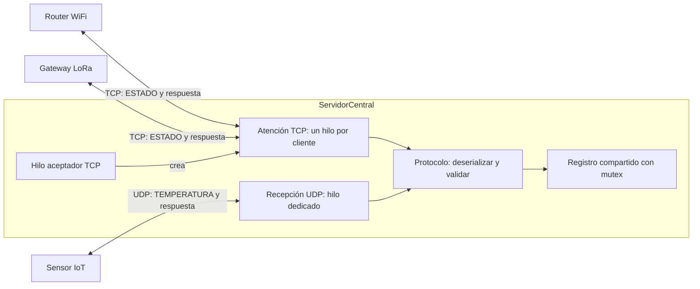
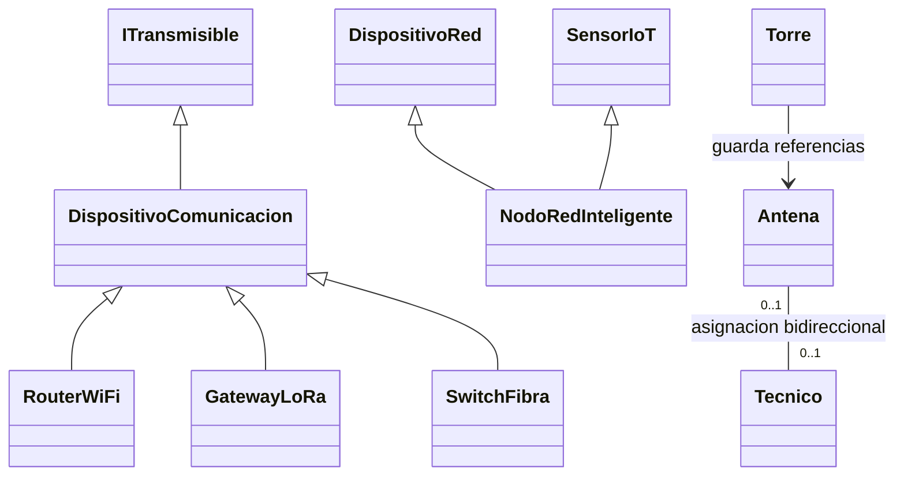

# TelcoCauca

Sistema distribuido concurrente de monitoreo de infraestructura de telecomunicaciones e IoT, desarrollado en **C++11** para Programación Orientada a Objetos. Incluye demostraciones de modelado del dominio, herencia múltiple, polimorfismo, hilos y comunicación TCP/UDP.

**Universidad del Cauca - FIET - 2026.2**<br>
**Docente:** Paola Andrea Bedoya Toro (`PABTORO`)<br>
**Integrantes:** Juan Esteban Caldon Rengifo y Kevin Camilo Salazar Cordoba

## Requisitos

- Compilador de C++11 con soporte para `std::thread` y `std::mutex`.
- En Windows: MinGW-w64 y la biblioteca Winsock (`ws2_32`).
- ZinjaI para abrir el proyecto `.zpr`, o una terminal con `g++` disponible.
- Para las demostraciones de red, permitir la comunicación local con `127.0.0.1`.

El proyecto de ZinjaI configura C++11, `-pthread` y el enlace con `-pthread -static -lws2_32`. Su toolchain está identificado como `mingw64-gcc7`; si no está instalado, seleccione en ZinjaI un compilador compatible disponible en su equipo.

## Compilación y ejecución

### Con ZinjaI

1. Descargar o clonar el repositorio completo y conservar juntos los archivos `.h`, `.cpp` y `.zpr`.
2. Abrir `TelcoCauca.zpr`.
3. Seleccionar la configuración **C++11** y compilar el proyecto completo.
4. Ejecutar el programa y elegir una opción del menú.

### Con g++ en Windows

Desde PowerShell, ubicado en la carpeta del repositorio y con MinGW-w64 en el `PATH`:

```powershell
g++ -std=c++11 -Wall -Wextra -pthread *.cpp -o TelcoCauca.exe -lws2_32
.\TelcoCauca.exe
```

### Con g++ en Linux

El código contiene una capa de sockets para Windows y POSIX. En Linux, el comando equivalente es:

```bash
g++ -std=c++11 -Wall -Wextra -pthread *.cpp -o TelcoCauca
./TelcoCauca
```

## Opciones del menú

| Opción | Demostración | Conceptos principales |
| --- | --- | --- |
| 1 | Infraestructura física | Asociación Torre–Antena 1:N y Antena–Tecnico 1:1; validación de datos. |
| 2 | Herencia múltiple y excepciones | `NodoRedInteligente` como `DispositivoRed` y `SensorIoT`; operadores y excepciones. |
| 3 | Polimorfismo e interfaces | Router WiFi, gateway LoRa y switch de fibra; despacho dinámico e interfaz `ITransmisible`. |
| 4 | Concurrencia y eventos 2027 | Hilos de supervisión y eventos; registro compartido y contador protegidos con mutex. |
| 5 | Comunicación TCP/UDP | Clientes concurrentes, serialización binaria, ACK/NACK e inyección de fallos. |
| 6 | Demostración completa | Ejecuta los cinco módulos y muestra un resumen. |
| 7 | Procesos independientes | En Windows, abre consolas para servidor, router, gateway y sensor. |
| 0 | Salir | Cierra el menú. |

La opción 5 inicia su propio servidor con puertos libres asignados por el sistema; no requiere iniciar previamente el modo `--servidor`.

## Servidor y clientes en procesos independientes

Todos los ejemplos siguientes se ejecutan en el **mismo equipo**. El modo servidor escucha en `127.0.0.1`, con el puerto **5000** como valor predeterminado para TCP y UDP. Ambos protocolos pueden usar el mismo número de puerto.

1. En una terminal, iniciar el servidor y esperar el mensaje `Servidor listo`:

   ```powershell
   .\TelcoCauca.exe --servidor 5000
   ```

2. En otras terminales, ejecutar los clientes:

   ```powershell
   .\TelcoCauca.exe --router 127.0.0.1 5000 --sinpausa
   .\TelcoCauca.exe --gateway 127.0.0.1 5000 --sinpausa
   .\TelcoCauca.exe --sensor 127.0.0.1 5000 --sinpausa
   ```

3. Comprobar el resumen de cada cliente: en una ejecución correcta indica `enviadas=3 ACK=3 NACK=0`. Router y gateway usan TCP; el sensor usa UDP.
4. Pulsar **ENTER en la consola del servidor** para detenerlo ordenadamente.

Para detener el servidor automáticamente después de 30 segundos:

```powershell
.\TelcoCauca.exe --servidor 5000 30 --sinpausa
```

`--sinpausa` evita la espera final de ENTER en los clientes y en el servidor con duración positiva; no sustituye la orden de detener un servidor sin duración. En Linux, usar `./TelcoCauca` en lugar de `.\TelcoCauca.exe` y abrir las terminales manualmente.

## Verificación de los cinco módulos

```powershell
.\TelcoCauca.exe --pruebas
$LASTEXITCODE
```

Una ejecución correcta termina con `RESULTADO GLOBAL: TODOS LOS MODULOS CORRECTOS` y código de salida **0**. El modo `--pruebas` devuelve **1** si alguna verificación falla.

Las pruebas provocan intencionalmente errores: punteros nulos, temperaturas fuera de rango, CRC corrupto, desconexiones a mitad de trama, inactividad y puertos ocupados. Ver mensajes `ERROR`, `NACK` o `Excepcion esperada` durante estos casos es normal: revise las líneas `[OK]`/`[FALLO]` y el resultado global. El orden de los mensajes de los hilos puede variar entre ejecuciones.

## Organización del código

| Archivos | Responsabilidad |
| --- | --- |
| `main.cpp` | Menú y argumentos de línea de comandos. |
| `Demo.h`, `Demo.cpp` | Demostraciones y verificaciones de los cinco módulos. |
| `Torre`, `Antena`, `Tecnico` (`.h`/`.cpp`) | Infraestructura física y asociaciones del dominio. |
| `DispositivoRed`, `SensorIoT`, `NodoRedInteligente` (`.h`/`.cpp`) | Herencia múltiple y validación del nodo. |
| `DispositivoComunicacion.h`, `ITransmisible.h`, `Dispositivos.h`, `Dispositivos.cpp` | Interfaces y dispositivos polimórficos. |
| `Supervisor`, `Registro`, `Eventos` (`.h`/`.cpp`), `GrupoHilos.h` | Supervisión concurrente, registro sincronizado y gestión de hilos. |
| `Socket`, `ServidorCentral`, `Clientes` (`.h`/`.cpp`), `PlataformaRed.h` | Sockets, servidor, clientes y adaptación Windows/POSIX. |
| `Protocolo.h`, `Protocolo.cpp` | Tramas binarias de 30 bytes, respuestas de 7 bytes y CRC-16. |
| `Excepciones.h`, `Util.h` | Excepciones del sistema y utilidades. |
| `TelcoCauca.zpr`, `.gitignore` | Configuración de ZinjaI y exclusión de archivos generados. |

## Arquitectura del sistema

### Comunicación entre procesos

Los modos de consola usan esta organización. Las flechas de doble sentido representan el envío de tramas y la respuesta ACK/NACK por el mismo transporte.



El servidor mantiene un hilo para aceptar conexiones TCP, uno para recibir datagramas UDP y un hilo por cliente TCP aceptado. Cada conexión TCP admite varias tramas. Al detenerse, espera la finalización de sus hilos con `join()` y cierra los sockets.

La demostración de red del menú ejecuta servidor y clientes dentro del mismo proceso, usando hilos. Los modos `--servidor`, `--router`, `--gateway` y `--sensor` permiten ejecutarlos en procesos separados. `SwitchFibra` participa en las demostraciones de polimorfismo y concurrencia; no tiene un modo de cliente de consola propio.

### Relaciones principales de clases



- `ITransmisible` define el contrato de serialización; `DispositivoComunicacion` es una base abstracta con `transmitir()` virtual puro y destructor virtual.
- `NodoRedInteligente` combina las capacidades de red y de sensor mediante herencia múltiple.
- Una torre agrupa varias antenas mediante punteros no propietarios. Antena y técnico pueden estar sin asignar; cuando se vinculan, la relación es exclusiva uno a uno.
- En las demostraciones polimórficas, los `unique_ptr` mantienen la propiedad de los dispositivos y el vector de punteros a la base permite utilizarlos sin asumir su propiedad.

## Protocolo binario TC v1

El formato está definido en [`Protocolo.h`](Protocolo.h) y su conversión en [`Protocolo.cpp`](Protocolo.cpp). `Trama` es el objeto de dominio; `TramaWire` es la representación de tamaño fijo enviada por la red. No se transmiten directamente objetos con `std::string` ni punteros.

### Trama de datos: 30 bytes

Los desplazamientos comienzan en cero. Los enteros de varios bytes se codifican en **orden de red (big-endian)**.

| Bytes | Campo | Tamaño | Contenido |
| --- | --- | --- | --- |
| 0–1 | `magic` | 2 | Firma ASCII `TC` (`0x54 0x43`). |
| 2 | `version` | 1 | Versión `1`. |
| 3 | `tipo` | 1 | `ESTADO = 1` o `TEMPERATURA = 2`. |
| 4–15 | `origen` | 12 | Identificador de 1 a 11 caracteres ASCII imprimibles; el emisor rellena con ceros. |
| 16–19 | `ip` | 4 | Dirección IPv4 declarada en la trama. |
| 20–23 | `secuencia` | 4 | Entero sin signo que identifica la trama para correlacionar su respuesta. |
| 24–27 | `valorMilli` | 4 | Entero con signo: `lround(valor * 1000)`. |
| 28–29 | `crc` | 2 | CRC-16/CCITT-FALSE calculado sobre los bytes 0–27. |

Para `ESTADO`, el valor de dominio es `0` o `1` y se codifica como `0` o `1000`. Para `TEMPERATURA`, se admiten lecturas entre **−40 y 85 °C**, inclusive. Por ejemplo, `24.5 °C` se representa como `24500` (`0x00005FB4`) y al recibir se divide entre `1000.0`.

El CRC usa valor inicial `0xFFFF`, polinomio `0x1021`, sin reflexión ni XOR final. Detecta corrupción de los datos; no autentica al emisor. `#pragma pack(push, 1)` elimina el relleno de las estructuras y los `static_assert` comprueban sus tamaños; las conversiones `htonl`/`htons` y `ntohl`/`ntohs` resuelven el orden de bytes.

### Respuesta ACK/NACK: 7 bytes

| Bytes | Campo | Tamaño | Contenido |
| --- | --- | --- | --- |
| 0–1 | `magic` | 2 | Firma ASCII `TR` (`0x54 0x52`). |
| 2 | `codigo` | 1 | `ACK = 0`: trama aceptada; `NACK = 1`: trama rechazada. |
| 3–6 | `secuencia` | 4 | Secuencia de la trama respondida, en orden de red. |

La respuesta no incluye CRC. El cliente comprueba su tamaño, firma, código y correspondencia de la secuencia. En UDP también comprueba que la respuesta venga de la IP y el puerto del servidor esperado.

### Recepción y validación

1. **TCP:** `recibirExacto()` reúne los 30 bytes de una trama; el cliente recibe los 7 bytes de respuesta. Una conexión puede transportar varias tramas consecutivas.
2. **UDP:** cada datagrama contiene una trama. El servidor verifica el tamaño recibido; si el datagrama supera su buffer de 512 bytes, lo descarta sin ACK/NACK.
3. `deserializar()` comprueba tamaño, firma, versión, CRC, terminador del origen y valores del dominio. Una trama aceptada se registra y produce ACK; un rechazo de validación produce NACK.
4. Para una trama de 30 bytes rechazada, el servidor extrae la secuencia sin validarla para construir el NACK. Si el tamaño es diferente, `secuenciaDe()` devuelve `0`.
5. Una desconexión TCP a mitad de trama o el cierre por inactividad se registra como error de conexión; no implica que se haya enviado un NACK. Los clientes UDP actuales no implementan reintentos automáticos.

## Solución de problemas

| Situación | Qué revisar |
| --- | --- |
| `g++` no se reconoce | Verificar la instalación del compilador y su carpeta `bin` en el `PATH`, o compilar desde ZinjaI. |
| Errores de símbolos Winsock al enlazar | En Windows, incluir `-lws2_32` al final del comando. |
| El compilador no reconoce `std::thread` | Usar un toolchain con soporte de hilos, C++11 y la opción `-pthread`. |
| `bind()` falla o el puerto está ocupado | Cerrar el servidor anterior o elegir otro puerto, por ejemplo `--servidor 5001`, y usarlo también en los clientes. |
| El cliente no conecta o agota el tiempo de espera | Iniciar primero el servidor, comprobar `Servidor listo` y verificar IP y puerto. |
| La opción 7 no abre consolas en Linux | Ejecutar manualmente los modos de servidor y clientes en terminales separadas. |

Los ejecutables, objetos y directorios de compilación están excluidos mediante `.gitignore`; cada integrante debe compilar el proyecto en su equipo.
